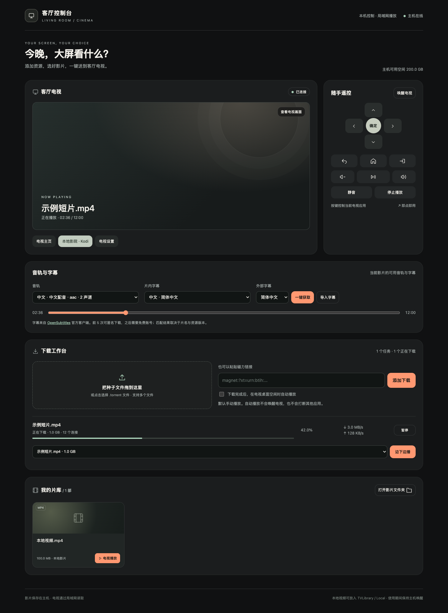

# Home TV Console · 家庭电视控制台

在本地浏览器里控制家中 Android TV 的显示和播放内容：切换应用、遥控电视、管理本地片库，把视频送到大屏播放。

服务运行在电脑上，通过局域网连接电视。电视使用 ADB 接收遥控指令，使用 Kodi 播放电脑提供的媒体流。无需云端控制服务。



## 功能

| 功能 | 当前支持 |
| --- | --- |
| 电视状态 | 查看连接状态、待机状态、前台应用及 Kodi 播放进度 |
| 网页遥控器 | 方向、确定、返回、主页、播放/暂停、停止、音量、静音、输入源、唤醒 |
| 应用切换 | 主页、Kodi、电视设置；可在私有配置中添加其他已安装应用 |
| 电视画面预览 | 按需截取当前画面；受 DRM 保护的画面可能为空 |
| 本地片库 | 扫描 `Local` 文件夹；已完成的视频下载自动加入片库 |
| 种子与磁力 | 拖入 `.torrent`、粘贴 magnet；查看进度、速度、节点数，暂停/继续 |
| 边下边播 | 选择种子内的视频，优先下载开头；只发送已通过校验的数据块 |
| 预约播放 | 获取元数据并完成起播缓冲后推送电视；可取消，30 分钟未起播则取消推送 |
| 音轨与字幕 | 播放时切换语言/音轨，选择片内字幕、关闭字幕，拖动播放进度 |
| 在线字幕 | 调用 OpenSubtitles 官方客户端，一键查找、下载并加载字幕 |
| 外部字幕 | 导入 SRT、ASS、SSA、VTT，立即加载到当前影片 |
| 空闲时自动播放 | 默认关闭；开启后，新完成的视频只在已知桌面或空闲 Kodi 中自动播放 |
| 下载恢复 | 保存种子、校验进度和暂停状态，服务重启后恢复；上传限速 1 MiB/s，完成后达到约 1 倍分享量暂停 |

## 支持范围

- **电脑**：macOS 优先，已在 Apple Silicon Mac 实测。Linux 提供相应路径和文件夹打开方式，但尚未完成电视实机验收；暂不声明支持 Windows。
- **电视**：支持网络 ADB 的 Android TV / Google TV。已在索尼 BRAVIA 9、Android 12 实测，其他型号的应用入口、输入源和待机唤醒行为可能不同。
- **播放器**：电视端 Kodi 21.x，开启带密码的 HTTP 远程控制。
- **依赖**：Python 3.9+（推荐 3.11）、Android SDK Platform-Tools 中的 `adb`。在线字幕另需 Node.js 24 和 npm。
- 当前管理页面只允许服务主机本机浏览器访问。电视通过局域网读取媒体，尚未提供手机端远程管理或多电视管理。

## 安装与配置

### 1. 准备电视

1. 安装 [Kodi](https://kodi.tv/download/android/)，选择符合电视 Android ABI 的版本。
2. 在 Kodi 的「设置 → 服务 → 控制」启用 **允许通过 HTTP 远程控制**，端口使用 `8080`，设置用户名和密码。无需开启无认证的其他远程控制接口。
3. 开启电视的开发者选项和网络 ADB 调试，在电视上授权这台电脑。部分系统使用 `5555`；采用无线调试配对的系统需要先执行 `adb pair`，并使用实际的连接端口。
4. 电脑和电视连接同一局域网，建议在路由器中为二者保留地址。

ADB 的安装和连接方式见 [Android 官方文档](https://developer.android.com/tools/adb)。该项目不会自动侧载应用、修改电视默认桌面或修改系统代理。

### 2. 安装主服务

```bash
git clone https://github.com/97wow/home-tv-console.git
cd home-tv-console
python3 -m venv .venv
source .venv/bin/activate
python -m pip install -r requirements.txt
python configure.py
```

配置向导会询问电视地址、本机局域网地址以及 Kodi 的用户名、密码。密码输入不回显，控制台密钥随机生成；私有配置写在源码目录之外。

接着连接电视，在电视屏幕上确认授权。把下面的 `TV_IP` 换成实际地址：

```bash
adb connect TV_IP:5555
adb devices
python run_console.py
```

打开 **<http://127.0.0.1:17880/>**。使用期间保持主机开机、唤醒，并允许电视访问主机的媒体端口。关闭终端会停止前台服务，再次运行同一命令即可恢复下载。

若 ADB 使用其他端口，配置时运行 `python configure.py --tv-port 连接端口`，并在 `adb connect` 中使用同一端口。

### 3. 可选：在线字幕

```bash
npm install --prefix subtitle-client
```

使用 [OpenSubtitles 官方 opensubs-cli](https://github.com/opensubtitles-dev/opensubs-cli)，按其许可和服务额度运行，不需要自行复制 API Key。当前客户端支持前 5 次匿名下载，之后需要免费账户；具体额度以服务方规定为准。

如果 npm 提示原生依赖构建脚本被阻止，请按其提示允许 `keytar` 和 `platform-folders` 的构建，再执行 `npm rebuild --prefix subtitle-client`。这些依赖可能需要系统编译工具；macOS 可通过 `xcode-select --install` 安装。

需要登录时，在本机终端运行官方客户端并按提示操作：

```bash
node subtitle-client/node_modules/opensubs-cli/dist/Run.js /实际路径/影片.mkv -l zh-cn
```

账户由官方客户端管理，凭据保存在系统钥匙串。网页不会要求你在聊天或源码中填写字幕账户密码。在线匹配依赖片名、版本和字幕库内容，也可以直接导入已有字幕。

## 私有配置与目录

默认运行目录：

- macOS：`~/Library/Application Support/HomeTVConsole`
- Linux：`${XDG_DATA_HOME:-~/.local/share}/HomeTVConsole`
- 可通过 `TV_CONSOLE_HOME` 指定其他运行目录。

其中 `data/config.json` 是私有配置，包含电视连接信息和密码，默认权限为 `600`。已有配置不会被向导覆盖；修改后重启服务。

常用配置项：

| 字段 | 用途 |
| --- | --- |
| `tv_host` / `tv_adb_port` | 电视 IPv4 地址和 ADB 连接端口 |
| `mac_host` | 电视能访问的服务主机 IPv4 地址，Linux 也使用这个字段 |
| `port` | 网页与媒体服务端口，默认 `17880` |
| `library` | 片库目录，默认 `~/Movies/TVLibrary` |
| `adb` / `adb_server_port` | ADB 可执行文件和本机 ADB 服务端口 |
| `adb_key` | 可选，自定义 ADB 私钥路径；留空使用 ADB 默认授权 |
| `tv_name` | 网页中显示的电视名称 |
| `apps` | 应用按钮，格式为 `"id": ["名称", "包名", "Activity"]`；Activity 留空时解析电视启动入口 |
| `idle_packages` | 可触发空闲自动播放的桌面包名列表 |
| `node` / `subtitle_proxy` | Node 可执行文件和可选字幕下载代理，默认不指定代理 |

添加应用时保留 `home`、`kodi` 两项。例如可以添加已安装的 Apple TV：

```json
"apple": ["Apple TV", "com.apple.atve.androidtv.appletv", ".MainActivity"]
```

片库中 `Local/` 放自己的视频，`Downloads/` 保存下载。项目不附带媒体、种子、字幕、应用安装包或任何家庭设备配置。

## 边下边播的实际限制

边下边播已用自制视频验证：下载约 25% 时，电视已播放并持续推进进度。音轨切换、片内字幕、外部字幕导入及在线字幕下载也已实测。

这不能保证每条磁力立即或流畅播放。起播需要取得元数据和已校验的开头数据；无节点、下载速度低于视频码率、跳转到尚未下载的区间，都可能长时间缓冲或超时。高码率 4K、杜比视界和多声道音频还取决于电视与 Kodi 的解码能力。本项目不提供自动转码，也不承诺所有 HDR 格式兼容。

手动点击「边下边播」表示允许缓冲就绪后切换电视内容；「下载完成后自动播放」是另一项独立的可选功能，会检查电视是否处于空闲状态。

## 访问边界

服务为电视提供媒体而监听局域网；管理页面和控制接口额外检查回环地址、Host、请求来源与控制令牌。媒体和字幕通过签名链接访问，服务限制可读文件路径并检查视频数据块是否完成校验。

签名链接本身具有访问对应文件的能力，请将服务用于可信家庭网络，不要把端口直接映射到公网。ADB 授权密钥和 `data/`、片库、下载记录不应提交到 Git。

## 开发与验证

```bash
python -m pip install -r requirements-dev.txt
python -m pytest -q
python -m compileall -q server.py streaming.py subtitles.py downloader.py configuration.py configure.py
```

测试使用临时配置和片库，不连接真实电视、不读取个人下载记录。覆盖路径限制、请求来源校验、HTTP Range、已验证数据块等待、播放排队、下载任务持久化等。真实电视与字幕服务的验收仍需实际设备和网络。

## 赞助商与友情链接

感谢以下赞助商对本项目的支持：

| 网站 | 身份 |
| --- | --- |
| [llmapi.pro](https://llmapi.pro) | 赞助商 |
| [3api.pro](https://3api.pro) | 赞助商 |

## 开源许可

项目源码使用 [MIT License](LICENSE)。ADB、Kodi、libtorrent 和 OpenSubtitles 客户端分别遵循其各自许可；本仓库仅集成接口和依赖，不重新分发这些程序或媒体内容。
